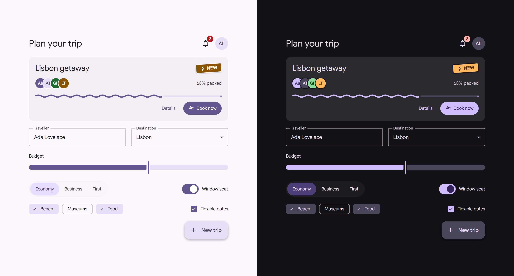

<div align="center">

# AnvilUI

**Material 3 components for React that feel alive.**

Accessible by default, themeable from a single color, and full of small moments of delight.

[](https://www.npmjs.com/package/anvilui)
[](core/LICENSE)
[](https://react.dev)
[](https://base-ui.com)

[Get started](#get-started) · [Components](#whats-inside) · [Docs](core/README.md) · [Using with AI agents](#built-for-ai-coding-agents)

<br />



</div>

---

AnvilUI is a React component library inspired by Google's Material 3. Buttons, dialogs, menus, date pickers, navigation and around 50 other components, ready to drop into your app.

Under the hood every interactive component is built on [Base UI](https://base-ui.com), so keyboard navigation, focus management and screen reader support are handled for you. On top of that, AnvilUI adds the part you'd otherwise spend weeks on: a cohesive look, springy motion, and a theme system that turns one brand color into a full light and dark palette.

## Highlights

- 🎨 **One color, whole theme.** `createTheme('#0B6E4F')` generates matching light and dark themes. Or pull the colors from an image with `createThemeFromImage`.
- 🌗 **Dark mode done right.** Follows the OS by default, remembers the user's choice, and applies it before first paint, so there's no flash with server rendering.
- ♿ **Accessible from the start.** Keyboard support, focus rings and ARIA come from Base UI. Icon-only controls require a label in their types, so you can't forget one.
- ✨ **Details that delight.** Numbers that roll like an odometer, squiggly progress bars, a hold-to-confirm button, a FAB that leans toward your cursor, and confetti when it's earned.
- 🪄 **Morphing transitions.** Grow a card into a dialog or a list row into a page with `morph()`, powered by View Transitions.
- 🔤 **Typed icons.** 3,900+ Material Symbols, referenced by name with autocomplete: `startIcon="rocket_launch"`.
- 🎚️ **Respects reduced motion.** Every animation shuts off when the user asks for less motion.
- 🤖 **Ready for AI coding agents.** Version-matched docs ship inside the package, so Claude Code, Cursor and Copilot can read the real API instead of guessing it.

## Get started

Install the package (requires React 19):

```sh
npm install anvilui
```

Import the stylesheet once, wrap your app in `AnvilRoot`, and start building:

```tsx
import { useState } from 'react'
import {
    AnvilRoot,
    Button,
    Card,
    CardActions,
    CardContent,
    CardTitle,
    Switch,
} from 'anvilui'
import 'anvilui/styles.css'

export function App() {
    const [notify, setNotify] = useState(true)

    return (
        <AnvilRoot defaultColorMode="system">
            <Card style={{ maxWidth: 360 }}>
                <CardTitle as="h2">Welcome aboard</CardTitle>
                <CardContent>
                    <label
                        style={{
                            display: 'flex',
                            gap: 12,
                            alignItems: 'center',
                        }}
                    >
                        <Switch checked={notify} onCheckedChange={setNotify} />
                        Send me product updates
                    </label>
                </CardContent>
                <CardActions>
                    <Button fillType="text">Skip</Button>
                    <Button startIcon="rocket_launch">Let's go</Button>
                </CardActions>
            </Card>
        </AnvilRoot>
    )
}
```

That's the whole setup: no theme provider, no toast provider, no Tailwind config. `AnvilRoot` takes care of theming, color mode, tooltips and snackbars.

### Make it yours

```tsx
import { AnvilRoot, createTheme } from 'anvilui'

const brand = createTheme('#0B6E4F')

<AnvilRoot lightTheme={brand.light} darkTheme={brand.dark} storageKey="color-mode">
    <App />
</AnvilRoot>
```

Spacing, corner radius, fonts, shadows and motion are design tokens you can override too. See [theming](core/docs/theming.md).

## What's inside

|                |                                                                                                                                   |
| -------------- | --------------------------------------------------------------------------------------------------------------------------------- |
| **Actions**    | Button, IconButton, SplitButton, HoldButton, Toggle, ToggleGroup, FAB, FABMenu, Chip, FilterChip, InputChip                       |
| **Forms**      | Input, Textarea, Select, Combobox, Search, Checkbox, Switch, RadioGroup, Slider, DateInput, TimePicker, Calendar, PinInput, Field |
| **Overlays**   | Dialog, BottomSheet, Popover, PreviewCard, Tooltip, Menu, ContextMenu, Menubar, snackbars                                         |
| **Navigation** | AppBar, NavigationBar, NavigationRail, NavigationDrawer, NavigationList, Tabs, FloatingToolbar                                    |
| **Content**    | Card, List, Table, Accordion, Carousel, Divider, Typography                                                                       |
| **Display**    | Avatar, AvatarGroup, Badge, Icon, Progress, Skeleton, Sticker, AnimatedNumber, Kbd                                                |

Every component has its own page in [`core/docs`](core/docs/llms-index.md) with props, examples and tips.

## Built for AI coding agents

AnvilUI is new, so AI models haven't learned it yet and tend to guess its API from other libraries. To fix that, the package ships its own docs: [`AGENTS.md`](core/AGENTS.md) plus a page per component, always matching the version you installed.

Point your agent at them with one command:

```sh
npx anvilui setup-agents
```

This adds a short note to your project's `AGENTS.md`, `CLAUDE.md`, `.cursorrules` or Copilot instructions. In development, common mistakes log a friendly `[anvilui]` error that shows the fix, so pasting the console back to your agent is usually enough. There's also an [`llms.txt`](public/llms.txt) for tools that read it.

## Documentation

- **[Package guide](core/README.md):** setup, color mode, themes and morphing
- **[Component docs](core/docs/llms-index.md):** one page per component
- **[Setup details](core/docs/setup.md):** fonts, Next.js, using theme variables in your own CSS
- **[API reference](core/AGENTS.md):** every export on one page

## Contributing

Contributions are welcome! The repo is an npm workspace:

- `core/` is the `anvilui` package
- `playground/` has an interactive page for every component (`npm run dev` inside it)

Read [CONTRIBUTING.md](CONTRIBUTING.md) for how components are built, styled and tested before opening a pull request.

## License

[MIT](core/LICENSE) © itayvak
