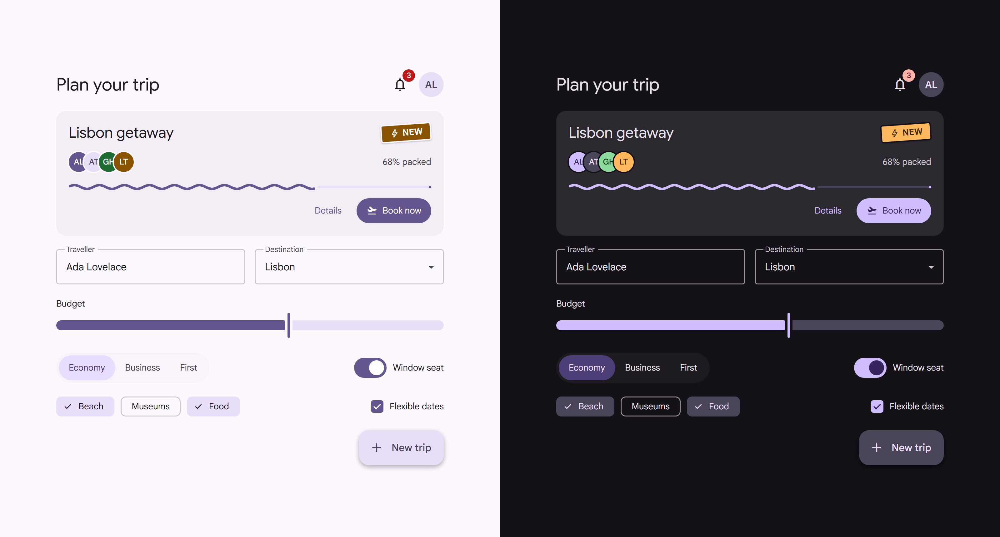

# anvilui

**Material 3 Expressive for the web, pushed further.**

React components that bounce, stretch, roll and react. AnvilUI brings Google's [Material 3 Expressive](https://m3.material.io/) to React, then keeps going where the spec stops: buttons with weight, selections that stretch, numbers that roll and progress that ripples. Around 50 components, all built on [Base UI](https://base-ui.com), so keyboard, focus and screen reader support come built in.



## Install

Requires React 19.

```sh
npm install anvilui
```

## Setup

Import the stylesheet once and wrap your app in `AnvilRoot`. That's the only provider: it handles theming, color mode, tooltips and snackbars.

```tsx
import { AnvilRoot, Button } from 'anvilui'
import 'anvilui/styles.css'

export function App() {
    return (
        <AnvilRoot defaultColorMode="system">
            <Button startIcon="rocket_launch">Hello</Button>
        </AnvilRoot>
    )
}
```

- Styles only apply inside `AnvilRoot`. To theme the whole page, give it a `className` that fills the viewport (`min-height: 100vh`).
- Icons come from the `material-symbols` font, so your bundler needs to handle CSS and font files from `node_modules` (Vite, Next.js and webpack do by default).
- The default theme uses Google Sans, which AnvilUI doesn't load for you. See [setup](https://github.com/itayvak/anvilui/blob/main/core/docs/setup.md) for the font link, Next.js and more.

## Make it yours

```tsx
import { AnvilRoot, createTheme } from 'anvilui'

const brand = createTheme('#0B6E4F') // or: await createThemeFromImage(file)

<AnvilRoot lightTheme={brand.light} darkTheme={brand.dark} storageKey="color-mode">
    <App />
</AnvilRoot>
```

One color becomes a full light and dark palette. Color mode follows the OS by default, and with `storageKey` the user's choice is remembered and applied before first paint. Spacing, radius, fonts and motion are tokens you can override too. See [theming](https://github.com/itayvak/anvilui/blob/main/core/docs/theming.md).

## Using with AI coding agents

AnvilUI is new, so AI models don't know its API and will guess it from other libraries. The package ships accurate, version-matched docs for agents: [`AGENTS.md`](https://github.com/itayvak/anvilui/blob/main/core/AGENTS.md) plus one page per component in `docs/`.

Run this once in your project to point your agent at them:

```sh
npx anvilui setup-agents
```

It appends a short note to whichever of `AGENTS.md`, `CLAUDE.md`, `.cursorrules` or `.github/copilot-instructions.md` exist, or creates `AGENTS.md`. To add it by hand, paste this:

```md
## AnvilUI

This project uses the `anvilui` React component library. Its API differs from shadcn/ui, Radix and MUI, so don't guess it. Before writing or changing UI code that uses it, read `node_modules/anvilui/AGENTS.md`, then the page for each component you use in `node_modules/anvilui/docs/` (index: `node_modules/anvilui/docs/llms-index.md`). These docs match the installed version; prefer them over memory.
```

In development, mistakes like a missing stylesheet, `asChild`, `variant` or a missing `aria-label` log an `[anvilui]` error that shows the fix and names the doc page, so pasting the console output back to your agent is enough. These checks are removed from production builds.

## Documentation

- [Component docs](https://github.com/itayvak/anvilui/blob/main/core/docs/llms-index.md): one page per component, with props and examples
- [Theming and color mode](https://github.com/itayvak/anvilui/blob/main/core/docs/theming.md)
- [Forms and validation](https://github.com/itayvak/anvilui/blob/main/core/docs/forms.md)
- [Morphing between views](https://github.com/itayvak/anvilui/blob/main/core/docs/morph.md) with `morph()`
- [API reference](https://github.com/itayvak/anvilui/blob/main/core/AGENTS.md): every export on one page

## License

MIT
